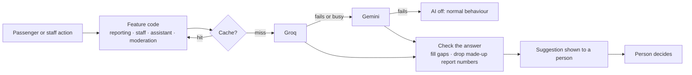
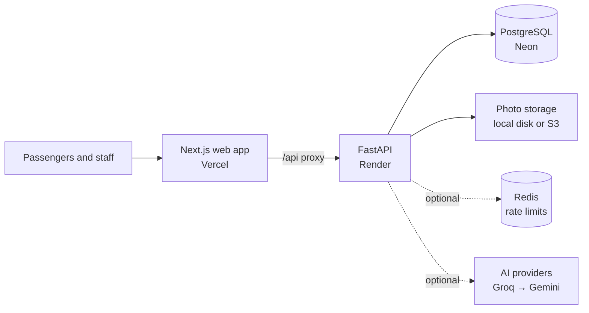

<div align="center">

# 🚆 RailVoice

### Report it. Back it. Track it until it's fixed.

Public problem reporting for Western Railway stations, **Churchgate → Virar**, with AI that helps passengers report and helps staff fix.

[](https://github.com/Frpratik/rail-voice/actions/workflows/ci.yml)
[](https://rail-voice.vercel.app)


**[Live demo](https://rail-voice.vercel.app)** · **[API docs](https://railvoice-api.onrender.com/docs)** · **[Documentation](docs/README.md)**

</div>

> [!IMPORTANT]
> **RailVoice is a prototype of Resolvia.** It exists to prove the idea end to end on one real railway corridor. It is not an official Indian Railways or Western Railway service, and it isn't monitored as an emergency channel.


## The idea

A broken lift or an unsafe platform edge gets noticed by hundreds of passengers and reported by few. Reports that are made tend to disappear, and the same problem gets filed again and again.

RailVoice gives each problem one public record:

1. **A passenger reports** the problem at a station, with photos, by typing or speaking in their own language.
2. **Others back the report** instead of filing duplicates, so the biggest problems rise to the top.
3. **Station staff work the queue**, updating the status at every step on a public timeline.
4. **The reporter confirms the fix**. If it isn't really fixed, the report goes back to staff.

## Try it

Open the **[live demo](https://rail-voice.vercel.app)** and sign in with OTP `123456`:

| Role | Mobile | What you can do |
|---|---|---|
| Passenger | `+919111111111` | Report, back, comment, track |
| Station Admin (Bandra) | `+919888888888` | Work Bandra's queue |
| Main Admin | `+919999999999` | Oversee every station, manage users |

> [!NOTE]
> The demo runs on free hosting, so the first request can take about a minute to wake the API. OTP is mocked, so anyone can use these accounts: don't enter real personal details. Uploaded photos may disappear when the server restarts.

## ✨ AI features

AI is **optional and off by default**. With no key set, every AI button simply disappears and the app works exactly as before. Add a free Groq or Gemini key and 14 helpers switch on.

### For passengers

| | Feature | What it does |
|---|---|---|
| ✍️ | **Write my report** | Type a rough note in Hindi, Marathi, Gujarati, Hinglish or English, such as *"platform 3 pe escalator band hai"*. AI fills in the title, description, problem type and emergency flag for you to check. |
| 🎙️ | **Speak instead** | Say the problem out loud in your language; it becomes the note above. |
| 📷 | **Photo understanding** | After you add a photo, AI says what it sees and suggests the problem type. It warns you if the photo shows a hazard. |
| 🔁 | **Smarter duplicate check** | Finds reports of the same problem even in different words ("moving stairs" = "escalator") and says why they match. |
| 💬 | **Ask RailVoice** | A chat that answers *"Has the Andheri escalator been reported?"* from real public reports, with links. |
| 🌐 | **Translate any report** | Read any report in English, हिन्दी, मराठी or ગુજરાતી. |
| 🚉 | **Station right now** | A short summary on each station page: what's broken, what was fixed recently, what to plan around. |

### For railway staff

| | Feature | What it does |
|---|---|---|
| 🌅 | **Today's briefing** | A start-of-shift summary on the control room: what to do first, patterns, next steps. |
| 💬 | **Suggested replies** | Type quick notes like *"cleaner sent, 30 min"*; AI writes a polite public update in English and the passenger's language. |
| 🧭 | **Department and urgency** | Suggests which team should take a report and how urgent it is, with a one-click "Use this department". |
| 🛡️ | **Spam and abuse screening** | Checks every new report in the background. Doubtful ones go to the Flagged queue for a person to decide. Nothing is hidden automatically. |
| 🔍 | **Why problems keep coming back** | For problems reported again and again, AI suggests the pattern, the likely cause and a lasting fix. |
| 📑 | **Monthly report** | A printable monthly summary for senior officials. RailVoice counts the figures; AI writes the words. |
| 📸 | **Before/after fix check** | Compares the passenger's photo with the staff proof-of-fix photo and says whether it looks fixed. |

### How the AI works, end to end



1. **A person does something:** writes a note, opens a station page, clicks "Suggest department".
2. **The feature builds a prompt** from public report text and figures only. Names and mobile numbers are never included. User text is fenced off and the model is told to ignore any instructions inside it.
3. **The answer is cached** where it doesn't change often (translations, station summaries, briefings, monthly reports), so the same question doesn't cost twice.
4. **Providers are tried in order.** If Groq is down or rate limited, Gemini takes over automatically. If all fail, the feature quietly falls back: the duplicate check uses keyword matching, the buttons say "not available right now", and reporting never breaks.
5. **Every answer is checked** against a fixed shape. Unknown categories become "Other", report numbers the AI invented are dropped, and missing fields are filled in.
6. **A person decides.** AI only suggests: it never changes a status, hides a report or sends a message on its own. Every AI box is labelled as written by AI.

### Providers

| Provider | Used for | Default model | Free key |
|---|---|---|---|
| **Groq** (first) | Text | `openai/gpt-oss-120b` | [console.groq.com/keys](https://console.groq.com/keys) |
| | Photos | `qwen/qwen3.8-27b` | |
| **Google Gemini** (fallback) | Text and photos | `gemini-3.8-flash` | [aistudio.google.com/apikey](https://aistudio.google.com/apikey) |
| **Anthropic Claude** (optional) | Text and photos | `claude-opus-5-5` | Paid |

Turn it on by setting these on the API (Render → your service → **Environment**):

```bash
AI_PROVIDER=groq,gemini      # tried in this order
GROQ_API_KEY=gsk_...
GEMINI_API_KEY=AIza...
```

A provider without a key is skipped, so `groq,gemini` with only a Groq key just uses Groq. Model names can be changed with `GROQ_MODEL`, `GROQ_VISION_MODEL` and `GEMINI_MODEL`. Free tiers have rate limits; the fallback and caching are there to stretch them.

> [!NOTE]
> When AI is on, report text and photos are sent to the AI provider. The [privacy page](https://rail-voice.vercel.app/privacy) says so.

## Features

### For passengers

- 🗺️ **Line map:** the corridor as a route diagram with open reports per station. Click a station to filter the feed.
- 🎫 **Ticket-style reports:** every issue has a number, a status and a station stub.
- 🔁 **Duplicate check:** before you submit, see similar open reports at that station and back one instead.
- ✅ **Confirm the fix:** say whether it's really fixed, or send it back to staff.
- ↩️ **Withdraw:** take a report back any time before work starts.
- 🚩 **Flag:** mark spam, abuse or false reports for review.
- 🔔 **Notifications:** in-app updates whenever your report changes.
- 🆘 **Emergency numbers:** safety reports show railway helpline 139, RPF 182 and emergency 112.
- 📍 **Use my location:** finds the nearest station for reports and the feed.
- 👤 **No account needed:** browse freely, and report anonymously if you prefer.
- ⭐ **Follow and favourite:** get updates on any report and keep your regular stations handy.
- 🌟 **Rate the fix:** score it after a report is fixed, and see staff proof photos.
- 🏅 **Points and badges:** earned for useful reports, with a public leaderboard.
- 🌐 **Hindi and Marathi:** for navigation, the feed, the report form and statuses.
- 📲 **Installable app:** works as a PWA, with pages available on poor networks.
- 🔍 **Station pages:** live stats, sharing, and a printable QR poster.
- 🔒 **Your data:** download it or delete your account from your profile. Photo location data is removed on upload.

### For railway staff

- 🟡 **Control room:** departure-board dashboard with open, in-progress, resolved and emergency counts, plus resolution time and SLA breaches.
- 📋 **Issue queue:** verify, reject and progress reports through a defined status flow.
- 👷 **Assign and escalate:** to an officer, the station manager, the division or the zone.
- 📍 **Location scoping:** station admins only see their own stations. AI features respect this too.
- 📣 **Alerts:** notified of new, urgent, reopened and repeatedly flagged reports.
- 🛡️ **Moderation:** review flags from passengers and the AI check, then remove or dismiss.
- 📄 **Exports:** Excel and PDF reports.
- 👥 **User management:** roles, locks, station assignment and an audit trail.
- ⏱️ **Target times:** each report gets a countdown, and overdue reports escalate automatically.
- 📝 **Private notes:** staff-only notes, reply templates and proof-of-fix photos.
- 🧰 **Queue tools:** bulk updates, merging duplicates, departments and "assigned to me".
- 📊 **Analytics:** trends, categories, stations, departments and recurring problems.
- 🔄 **Shift handover:** what is new, overdue and recently changed.
- 🌍 **Public transparency page:** each station's fix rate, for anyone to see.

<table>
  <tr>
    <td width="50%"></td>
    <td width="50%"></td>
  </tr>
  <tr>
    <td align="center"><b>Control room</b></td>
    <td align="center"><b>Duplicate check</b></td>
  </tr>
</table>

## How it's built



| Layer | Stack |
|---|---|
| **Web** | Next.js 16, React 19, Tailwind 4, TanStack Query, Zustand |
| **API** | FastAPI, async SQLAlchemy, Pydantic, Alembic |
| **Data** | PostgreSQL 16, optional Redis, local or S3 file storage |
| **AI** | Groq and Google Gemini over HTTPS with automatic fallback, optional Anthropic Claude, in-memory answer cache |
| **Security** | JWT with rotating refresh tokens and reuse detection, hashed mobile numbers, role-based access, rate limits, idempotency keys, audit logs |
| **Delivery** | GitHub Actions, Docker, Render, Vercel |

## Run it locally

**With Docker**

```bash
cp railvoice-backend/.env.example railvoice-backend/.env
docker compose up --build
```

The web app is at http://localhost:3000 and the API docs are at http://localhost:8000/docs.

**Without Docker** (needs PostgreSQL running)

```bash
cd railvoice-backend
python -m venv .venv && source .venv/bin/activate   # Windows: .venv\Scripts\activate
pip install -r requirements.txt
cp .env.example .env
alembic upgrade head
python -m app.scripts.seed
uvicorn app.main:app --reload
```

```bash
cd railvoice-web
cp .env.local.example .env.local
npm install
npm run dev
```

The seed only inserts demo data into an empty database. To wipe and reseed, run `python -m app.scripts.seed --reset`.

**Try the AI without a key:** set `AI_PROVIDER=fake` in `railvoice-backend/.env`. A built-in demo AI gives fixed, predictable answers so you can click through every feature. It is refused in production.

## Tests

```bash
cd railvoice-backend
PYTHONPATH=. pytest -v --cov=app
```

Tests need a migrated, seeded PostgreSQL database. The AI tests use the demo AI and mocked Groq and Gemini responses, so they need no keys and cost nothing. CI runs everything on every push, with a 55% coverage floor, plus the frontend build and lint.

## Project layout

```text
railvoice-backend/
├── app/ai/         AI: provider clients and fallback, prompts for each feature, cache
├── app/api/v1/     Routes: auth, issues, search, admin, users, social, ai
├── app/core/       Config, security, rate limits, idempotency
├── app/models/     Database models
├── app/services/   Business logic
├── alembic/        Migrations
└── tests/
railvoice-web/
└── src/            Pages, components (AI pieces in components/ai), API client
deploy/             Nginx and production config
docs/               Product, API and operations documentation
```

## Deployment

- **Free demo** (Neon + Render + Vercel): [FREE_DEPLOY.md](FREE_DEPLOY.md)
- **Self-hosted** (Docker Compose + Nginx): [DEPLOY.md](DEPLOY.md)
- **AI:** add `AI_PROVIDER`, `GROQ_API_KEY` and `GEMINI_API_KEY` to the API's environment, then redeploy.

## Prototype status

Since this is a prototype, some things a public service would need aren't in place yet:

- [ ] Real SMS OTP (the code supports Twilio and MSG91; the demo uses mock codes)
- [ ] Durable photo storage in the live demo (S3 is supported but not switched on)
- [ ] SMS or email notifications for passengers
- [ ] AI answers checked against real-world use (tested so far with the demo AI and mocked providers)
- [ ] Adoption by a real station office

Parts of `docs/` were written during earlier design phases and describe features that have since been removed. This README reflects the current app.

---

<div align="center">

**RailVoice is a prototype of Resolvia.**

Not affiliated with or endorsed by Indian Railways.

</div>
