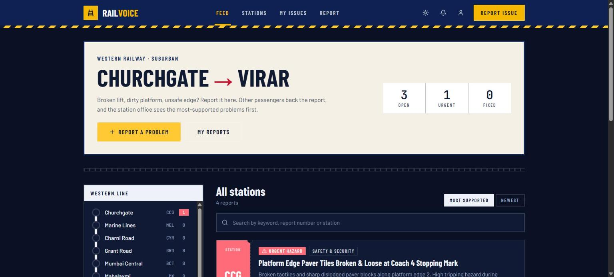
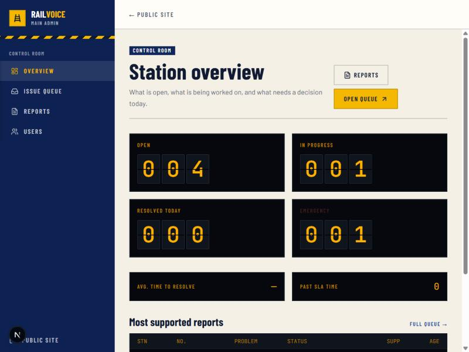
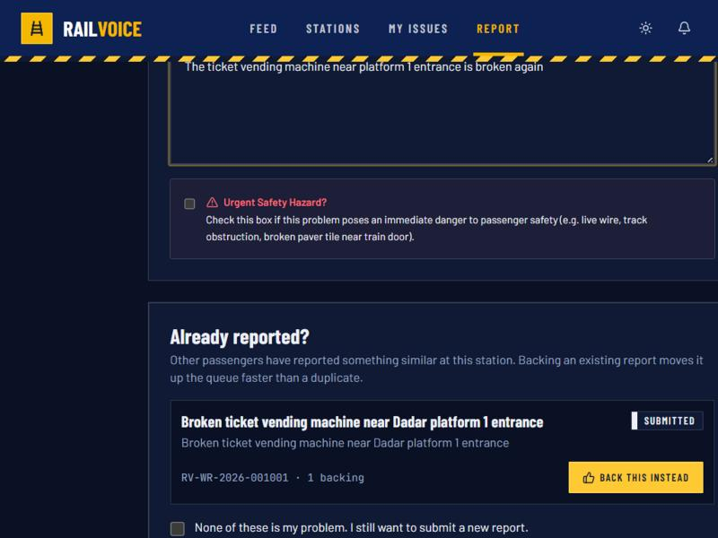
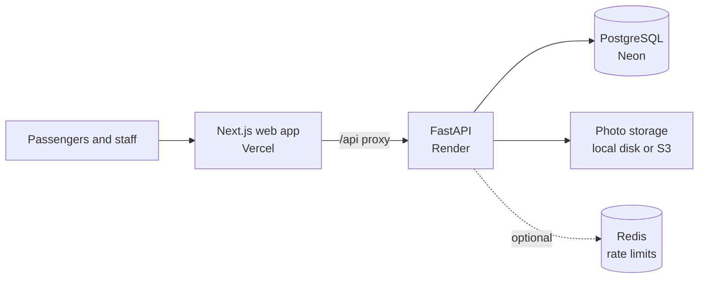

<div align="center">

# 🚆 RailVoice

### Report it. Back it. Track it until it's fixed.

Public problem reporting for Western Railway stations, **Churchgate → Virar**.

[](https://github.com/Frpratik/rail-voice/actions/workflows/ci.yml)
[](https://rail-voice.vercel.app)


**[Live demo](https://rail-voice.vercel.app)** · **[API docs](https://railvoice-api.onrender.com/docs)** · **[Documentation](docs/README.md)**

</div>

> [!IMPORTANT]
> **RailVoice is a prototype of Resolvia.** It exists to prove the idea end to end on one real railway corridor. It is not an official Indian Railways or Western Railway service, and it isn't monitored as an emergency channel.



## The idea

A broken lift or an unsafe platform edge gets noticed by hundreds of passengers and reported by few. Reports that are made tend to disappear, and the same problem gets filed again and again.

RailVoice gives each problem one public record:

1. **A passenger reports** the problem at a station, with photos.
2. **Others back the report** instead of filing duplicates, so the biggest problems rise to the top.
3. **Station staff work the queue**, updating the status at every step on a public timeline.
4. **The reporter confirms the fix**. If it isn't really fixed, the report goes back to staff.

## Try it

Open the **[live demo](https://rail-voice.vercel.app)** and sign in with OTP `123456`:

| Role | Mobile | What you can do |
|---|---|---|
| Passenger | `+919111111111` | Report, back, comment, track |
| Station Admin (Bandra) | `+919888888888` | Work Bandra's queue |
| Main Admin | `+919999999999` | Oversee every station, manage users |

> [!NOTE]
> The demo runs on free hosting, so the first request can take about a minute to wake the API. OTP is mocked, so anyone can use these accounts: don't enter real personal details. Uploaded photos may disappear when the server restarts.

## Features

### For passengers

- 🗺️ **Line map:** the corridor as a route diagram with open reports per station. Click a station to filter the feed.
- 🎫 **Ticket-style reports:** every issue has a number, a status and a station stub.
- 🔁 **Duplicate check:** before you submit, see similar open reports at that station and back one instead.
- ✅ **Confirm the fix:** say whether it's really fixed, or send it back to staff.
- ↩️ **Withdraw:** take a report back any time before work starts.
- 🚩 **Flag:** mark spam, abuse or false reports for review.
- 🔔 **Notifications:** in-app updates whenever your report changes.
- 🆘 **Emergency numbers:** safety reports show railway helpline 139, RPF 182 and emergency 112.
- 📍 **Use my location:** finds the nearest station for reports and the feed.
- 👤 **No account needed:** browse freely, and report anonymously if you prefer.
- ⭐ **Follow and favourite:** get updates on any report and keep your regular stations handy.
- 🌟 **Rate the fix:** score it after a report is fixed, and see staff proof photos.
- 🏅 **Points and badges:** earned for useful reports, with a public leaderboard.
- 🌐 **Hindi and Marathi:** for navigation, the feed, the report form and statuses.
- 📲 **Installable app:** works as a PWA, with pages available on poor networks.
- 🔍 **Station pages:** live stats, sharing, and a printable QR poster.
- 🔒 **Your data:** download it or delete your account from your profile. Photo location data is removed on upload.

### For railway staff

- 🟡 **Control room:** departure-board dashboard with open, in-progress, resolved and emergency counts, plus resolution time and SLA breaches.
- 📋 **Issue queue:** verify, reject and progress reports through a defined status flow.
- 👷 **Assign and escalate:** to an officer, the station manager, the division or the zone.
- 📍 **Location scoping:** station admins only see their own stations.
- 📣 **Alerts:** notified of new, urgent, reopened and repeatedly flagged reports.
- 🛡️ **Moderation:** review flags, then remove or dismiss.
- 📄 **Exports:** Excel and PDF reports.
- 👥 **User management:** roles, locks, station assignment and an audit trail.
- ⏱️ **Target times:** each report gets a countdown, and overdue reports escalate automatically.
- 📝 **Private notes:** staff-only notes, reply templates and proof-of-fix photos.
- 🧰 **Queue tools:** bulk updates, merging duplicates, departments and "assigned to me".
- 📊 **Analytics:** trends, categories, stations, departments and recurring problems.
- 🔄 **Shift handover:** what is new, overdue and recently changed.
- 🌍 **Public transparency page:** each station's fix rate, for anyone to see.

<table>
  <tr>
    <td width="50%"></td>
    <td width="50%"></td>
  </tr>
  <tr>
    <td align="center"><b>Control room</b></td>
    <td align="center"><b>Duplicate check</b></td>
  </tr>
</table>

## How it's built



| Layer | Stack |
|---|---|
| **Web** | Next.js 16, React 19, Tailwind 4, TanStack Query, Zustand |
| **API** | FastAPI, async SQLAlchemy, Pydantic, Alembic |
| **Data** | PostgreSQL 16, optional Redis, local or S3 file storage |
| **Security** | JWT with rotating refresh tokens and reuse detection, hashed mobile numbers, role-based access, rate limits, idempotency keys, audit logs |
| **Delivery** | GitHub Actions, Docker, Render, Vercel |

## Run it locally

**With Docker**

```bash
cp railvoice-backend/.env.example railvoice-backend/.env
docker compose up --build
```

The web app is at http://localhost:3000 and the API docs are at http://localhost:8000/docs.

**Without Docker** (needs PostgreSQL running)

```bash
cd railvoice-backend
python -m venv .venv && source .venv/bin/activate   # Windows: .venv\Scripts\activate
pip install -r requirements.txt
cp .env.example .env
alembic upgrade head
python -m app.scripts.seed
uvicorn app.main:app --reload
```

```bash
cd railvoice-web
cp .env.local.example .env.local
npm install
npm run dev
```

The seed only inserts demo data into an empty database. To wipe and reseed, run `python -m app.scripts.seed --reset`.

## Tests

```bash
cd railvoice-backend
PYTHONPATH=. pytest -v --cov=app
```

Tests need a migrated, seeded PostgreSQL database. CI runs them on every push, with a 55% coverage floor, plus the frontend build and lint.

## Project layout

```text
railvoice-backend/
├── app/api/v1/     Routes: auth, issues, search, admin, users, social
├── app/core/       Config, security, rate limits, idempotency
├── app/models/     Database models
├── app/services/   Business logic
├── alembic/        Migrations
└── tests/
railvoice-web/
└── src/            Pages, components, API client
deploy/             Nginx and production config
docs/               Product, API and operations documentation
```

## Deployment

- **Free demo** (Neon + Render + Vercel): [FREE_DEPLOY.md](FREE_DEPLOY.md)
- **Self-hosted** (Docker Compose + Nginx): [DEPLOY.md](DEPLOY.md)

## Prototype status

Since this is a prototype, some things a public service would need aren't in place yet:

- [ ] Real SMS OTP (the code supports Twilio and MSG91; the demo uses mock codes)
- [ ] Durable photo storage in the live demo (S3 is supported but not switched on)
- [ ] SMS or email notifications for passengers
- [ ] Hindi and Marathi interface
- [ ] Adoption by a real station office

Parts of `docs/` were written during earlier design phases and describe features that have since been removed. This README reflects the current app.

---

<div align="center">

**RailVoice is a prototype of Resolvia.**

Not affiliated with or endorsed by Indian Railways.

</div>
